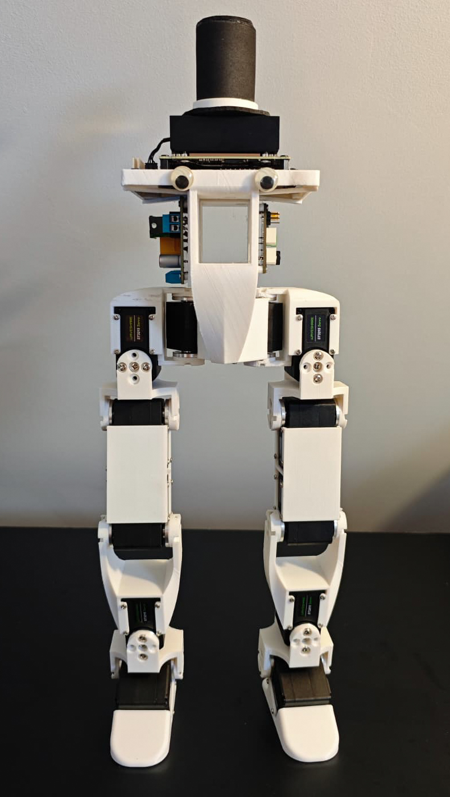
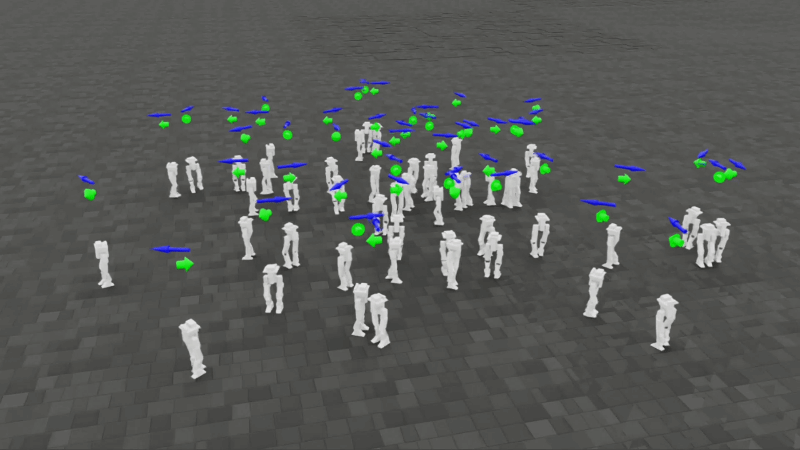
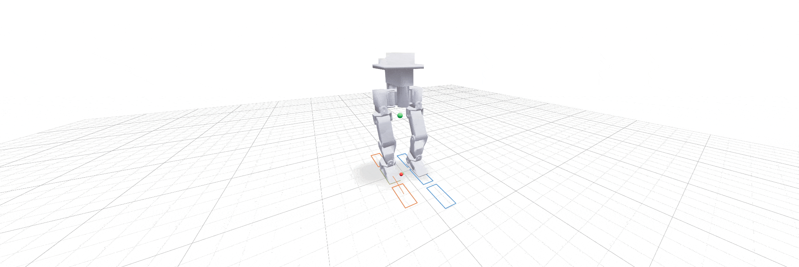
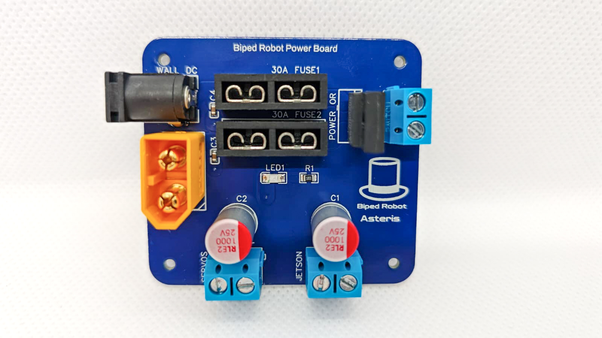

# BipedRobot

**A small and affordable 12-servo biped that learns to walk in simulation and runs the learned policy on the real robot.**
Everything in this repo was written from scratch: the RL algorithms, the network backbones, the
environments, the reward functions, the servo model and the gait generator.

<p align="center">
  
  &nbsp;
  
</p>

<p align="center">
  <em>Left: the robot (12× Feetech STS3215, Jetson Orin Nano, BNO055 IMU, 3D-printed body).
  Right: training in Isaac Lab. Each robot follows its own velocity command (arrows).</em>
</p>

---

## Features

- **Velocity-command walking** (forward, sideways, turning), trained in Isaac Lab with thousands of
  parallel robots, fully on the GPU.
- **Own RL library** ([`torch_rl_algorithms`](torch_rl_algorithms/)): SAC, PPO, DDPG, D4PG and MPO, with
  MLP and Transformer backbones selectable from the config (CNN and LSTM exist in the library).
- **Realistic actuators.** An identified model of the real STS3215 servos (Rhoban's
  [BAM](https://github.com/Rhoban/bam), ported to batched torch), with gear backlash and the
  firmware dead zone, runs in both simulators.
- **Sim-to-real tooling:**
  - per-channel sensor noise, delays and biases;
  - physics randomization;
  - left/right symmetry (mirror augmentation or an exactly equivariant actor);
  - a MuJoCo sim-to-sim check;
  - a pre-deploy gate for the exported policy.
- **Everything in YAML.** Algorithm, network, rewards, randomization, commands, servo model and
  action map are all set in one config file, validated by a schema.
- **Optional reference motion.** [Gait Studio](#optional-reference-motion-with-gait-studio) lets
  you design a gait in the browser and train the policy to imitate it. Training works without it.
- **One-command deployment** to a self-contained ONNX bundle for the robot's Jetson
  ([BipedRobotJetson](https://github.com/AsterisCrack/BipedRobotJetson)).

---

## Quick start

### 1. Install

```bash
git clone --recurse-submodules https://github.com/AsterisCrack/BipedRobot
cd BipedRobot
pip install -r requirements.txt        # also installs torch_rl_algorithms in editable mode
```

Training needs [Isaac Lab](https://isaac-sim.github.io/IsaacLab/main/source/setup/installation/index.html).
Run the training commands from `BipedRobot/` with Isaac Lab's Python. MuJoCo evaluation, export and
the gate run without it.

### 2. Train

```bash
python src/isaaclab/train.py --task BipedRobotV2 --config_path config/config.yaml --headless
```

| Argument | |
|---|---|
| `--task` | `BipedRobotV2` (current robot) or `BipedRobot` (the older V1) |
| `--config_path` | The YAML that defines the run (see [Configuring and experimenting](#configuring-and-experimenting)) |
| `--num_envs N` | Number of parallel robots; defaults to the env config |
| `--checkpoint <path>` | Resume from a checkpoint |
| `--headless` | No viewer; much faster |
| `--video` | Record clips during training |

TensorBoard logs go to `runs/`:

```bash
tensorboard --logdir runs
```

Checkpoints are written to `checkpoints/<model_name>_<timestamp>/step_<N>.pt`.

### 3. Watch the policy

```bash
# Isaac Lab (add --pushes to shove the robots)
python src/isaaclab/play.py --task BipedRobotV2 --checkpoint checkpoints/<run>/step_<N>.pt

# MuJoCo sim-to-sim with a fixed command: a different simulator and servo implementation
python src/mujoco/sim2real.py --checkpoint checkpoints/<run>/step_<N>.pt --vx 0.1
```

The run's own `config.yaml` is saved next to its checkpoints and picked up automatically.

### 4. Export and deploy

```bash
python -m src.isaaclab.export_onnx --checkpoint checkpoints/<run>/step_<N>.pt
python -m src.isaaclab.verify_onnx_bundle --bundle exported/<bundle>
python -m src.mujoco.policy_gate --bundle exported/<bundle>
```

| Step | What it does |
|---|---|
| **Export** | Writes `policy.onnx` and `deploy_config.json` (normaliser stats, action map, joint limits, gait clock, command limit, required servo gain). |
| **Verify** | Cross-checks the bundle against the training actor. |
| **Gate** | Runs the bundle in MuJoCo the way the robot does: same rate limiter, same history start. Fails it on falls, chatter, saturated joints or a bad standing pose. Exit code 0 = PASS. |

Copy the bundle to `models/<name>/` in [BipedRobotJetson](https://github.com/AsterisCrack/BipedRobotJetson).
It needs no torch, no Isaac Lab and nothing from this repo.

Every script and argument is listed in [`src/README.md`](src/README.md).

---

## Configuring and experimenting

A run is defined by one YAML file. Configs are validated against [`config/schema.py`](config/schema.py)
(every field, its type and its default): wrong types fail at startup, and the nested blocks
(`commands`, `actuator`, `backlash`, `reference`, noise channels) reject unknown keys. To try something, copy a config, change it, and pass it with `--config_path`. The run
directory keeps a copy, so every checkpoint stays reproducible.

| Config | Use |
|---|---|
| [`config.yaml`](config/config.yaml) | Start here: velocity tracking with hand-written gait rewards, no reference motion |
| [`config_gait_reference.yaml`](config/config_gait_reference.yaml) | Same, plus imitation of a Gait Studio gait table |
| [`config_gait_reference_resume.yaml`](config/config_gait_reference_resume.yaml) | Continue or fine-tune a run: frozen action map, curricula at full strength from step 1 |
| [`config_gait_reference_no_rand.yaml`](config/config_gait_reference_no_rand.yaml) | No randomization, for debugging |
| [`ablations/`](config/ablations/) | A generator for single-change variants (the committed snapshots are from an older `config.yaml`; regenerate before use) |

The sections below are the knobs you'll reach for most. The full reference is
[`config/README.md`](config/README.md).

### Algorithm and network

```yaml
train:
  model: "sac"                 # sac | ppo | ddpg | d4pg | mpo
  use_history: true
  history_size: 5              # observation frames stacked for the actor
  symmetry_augmentation: true  # mirrored transitions in the replay buffer
  equivariant_actor: true      # actor exactly mirror-symmetric by construction
model:
  actor_config:
    network_type: mlp          # mlp | transformer (the exported ONNX path supports mlp)
    hidden_sizes: [1024, 512, 256]
  critic_config:
    network_type: mlp
    hidden_sizes: [1024, 512, 256]
  actor_lr: 3.0e-4
  critic_lr: 3.0e-4
```

`buffer:` holds the replay settings (size, batch size, n-step returns, update ratio) and is required
for the off-policy algorithms. See [`config/README.md`](config/README.md) for the exploration and
learning-rate schedule keys.

### Rewards

Every term lives in one pure-PyTorch file,
[`envs/isaaclab/rewards/rewards.py`](envs/isaaclab/rewards/rewards.py), shared by Isaac Lab and
MuJoCo. Turn a term on by giving it a weight, and off with `0`:

```yaml
train:
  env_config:
    reward_weights:
      track_lin_vel_xy_exp: 2.0     # follow the velocity command
      track_ang_vel_z_exp: 1.5
      upright: 1.0
      action_rate_l2: -0.01         # smoothness
      feet_slide: -0.7
      foot_flat_l2: -5.0            # keep the soles flat on the ground
      # ... ~30 terms: tracking, posture, feet, effort, contacts
```

Penalties must be negative. A sign guard refuses to start a run where one isn't. Some terms have
their own shape parameters next to the weights: tracking kernel widths, swing clearance,
air-time window and sole geometry.

To add a term, write the function in `rewards.py`, register it in the env and give it a weight
([`envs/README.md`](envs/README.md) walks through it).

### Commands

```yaml
    commands:
      base_velocity:
        limit_shape: ellipse_xy       # or box: limit vx/vy jointly or per axis
        rel_standing_envs: 0.02       # share of robots told to stand still
        rel_turn_in_place_envs: 0.15
        ranges:
          lin_vel_x: [-0.2, 0.2]      # m/s
          lin_vel_y: [-0.15, 0.15]
          ang_vel_z: [-1.2, 1.2]      # rad/s
```

The command limit is exported with the policy, so the robot clamps commands the same way.

### Robustness: noise, delays, randomization

```yaml
    observation_noise_std:            # white noise per channel, in its own units
      imu_acc: 0.15
      gyro: 0.02
      joint_vel: 0.25
    observation_vibration_std:        # band-limited (3-10 Hz) sensor vibration; remove the block to disable
      imu_acc: 1.5
      gyro: 1.0
      joint_vel: 0.8
    action_delay_steps_range: [0, 1]  # control steps, drawn per episode
    imu_obs_delay_steps_range: [0, 1]
    imu_accel_bias: 0.2               # constant per episode
    mount_offset_rad: 0.0175          # servo zero error, constant per robot
    enable_perturbations: true        # pushes (both switches default to false)
    enable_physics_randomization: true
    events:                           # override event params (events the curriculum ramps take curriculum_dr_* values)
      randomize_friction:
        params:
          static_friction_range: [0.25, 0.8]
    curriculum_enabled: true          # ramp the randomization in
    curriculum_dr_full_steps: 20000
```

Terrain is set with `train.use_rough_terrain`.

### Servo model and backlash

```yaml
    actuator:
      params_file: actuator/params/sts3215_12v/m6.json   # identified BAM parameters
      kp_fw: 32                       # firmware P gain; must match the robot
      kp_fw_range: [32, 40]           # randomized per robot
      vin_range: [11.1, 12.6]         # supply voltage
      stall_torque_cap_nm: 2.94
    backlash:
      enabled: true
      lash_deg_range: [1.0, 2.5]      # gear play per joint
```

To model a different servo, identify it with the tools in [`actuator/`](actuator/README.md) (bench
recording, fit, validation, replay in both simulators) and point `params_file` at the result.

### Action map

```yaml
    action_map: residual              # target = clamp(home + scale * action)
    action_home_deg: {...}            # the pose for action = 0, per joint type
    action_scale_rad:
      hip_pitch: {pos: 0.6, neg: 0.8} # per joint type; optionally asymmetric
      knee: {pos: 0.55, neg: 0.8}
```

`centered` and `absolute` maps are also available. Changing the map invalidates existing
checkpoints, because the same action then means a different joint target.

---

## Optional: reference motion with Gait Studio

<p align="center">
  
</p>

Without a reference, the policy finds its own gait from the rewards. If you want a particular
walking style, design it in **Gait Studio**, a browser tool in the
[`robot_motion_reference`](robot_motion_reference/gait_studio/README.md) submodule:

- Shape the gait with knobs (cadence, step height, stance width, sway, heel-to-toe…).
- Check it against what the servos can do.
- Bake it into a table with one gait cycle per velocity command.

Training then adds imitation rewards for that table on top of the usual ones.

```bash
cd robot_motion_reference
pip install -r gait_studio/requirements.txt
python -m gait_studio.app                       # design: http://localhost:8080
python -m gait_studio.bake --style processed/gait_table_style.yaml --out processed/gait_table.npz
cd ..
python src/isaaclab/train.py --task BipedRobotV2 --config_path config/config_gait_reference.yaml --headless
```

To add imitation to your own config, add a `reference:` block pointing at the table and give the
`imitation_*` reward terms a weight. [`config_gait_reference.yaml`](config/config_gait_reference.yaml)
shows how. The training config stays the source of truth for commands and the action map; the
table only supplies motion and cadence.

---

## Project structure

```
BipedRobot/
├── config/                  Training configs + Pydantic schema
├── actuator/                Servo model (BAM kernel, backlash), identification, replay, parity tests
├── envs/
│   ├── isaaclab/            Isaac Lab env, env cfg, shared rewards, commands, randomization events
│   ├── mujoco/              MuJoCo env (sim-to-sim checks, gate)
│   └── assets/              Robot models (MJCF, USD, URDF)
├── src/
│   ├── isaaclab/            train, play, export_onnx, verify_onnx_bundle, diagnostics
│   ├── mujoco/              policy_gate, sim2real viewer, sweeps
│   └── tools/               Symmetry validators, interactive joint/IK debuggers
├── utils/                   Config loader, gait-table reader, command limit, action map, IK
├── tests/                   pytest suite
├── torch_rl_algorithms/     Submodule: RL algorithms and network backbones
└── robot_motion_reference/  Submodule: Gait Studio + FBX → joint-trajectory retargeting
```

| Further docs | |
|---|---|
| [`src/README.md`](src/README.md) | Every script and its arguments |
| [`config/README.md`](config/README.md) | Every config field |
| [`envs/README.md`](envs/README.md) | Environments, adding a robot, adding a reward term |
| [`actuator/README.md`](actuator/README.md) | Servo identification: method, results, parameters |
| [`robot_motion_reference/gait_studio/README.md`](robot_motion_reference/gait_studio/README.md) | Gait Studio |

```bash
python -m pytest tests -q --ignore=tests/test_env.py --ignore=tests/test_transformer.py   # two legacy test files are stale
```

---

## Hardware and custom PCB

- 12 Feetech STS3215 smart servos with position, speed, load, voltage and temperature feedback
- NVIDIA Jetson Orin Nano, 50 Hz control loop ([BipedRobotJetson](https://github.com/AsterisCrack/BipedRobotJetson))
- BNO055 IMU
- 3D-printed structure
- Custom power distribution PCB for stable, modular wiring

<p align="center">
  
</p>

<p align="center">
  <em>The custom power distribution PCB.</em>
</p>

The PCB was fabricated and assembled with support from <a href="https://www.pcbway.com/">PCB Way</a>.
Their service took the board from design to assembly quickly, which sped up hardware iteration.
They offer PCB prototyping, assembly and component sourcing.

🔗 https://www.pcbway.com/

---

## Acknowledgements

<p align="center">
  
</p>

Hardware development for this project was partially supported by <a href="https://www.pcbway.com/">PCB Way</a>
(PCB fabrication and assembly). All design decisions and evaluations remain fully independent.

The servo model builds on Rhoban's [BAM](https://github.com/Rhoban/bam). Gait Studio is inspired
by Disney Research's *Interactive Design of Stylized Walking Gaits for Robotic Characters*
(SIGGRAPH 2024).

---

## License

[MIT](LICENSE.txt)
