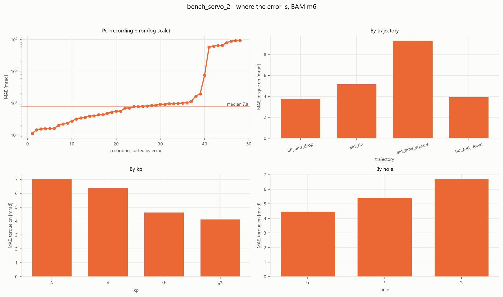
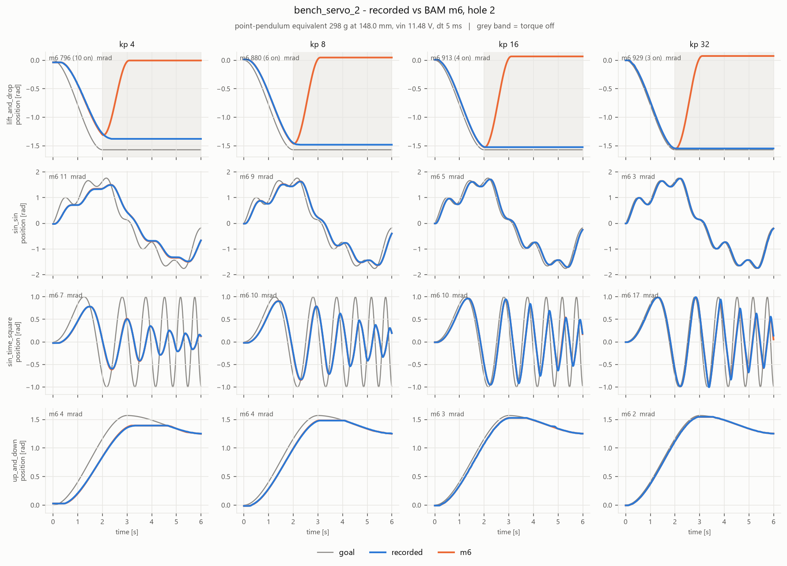
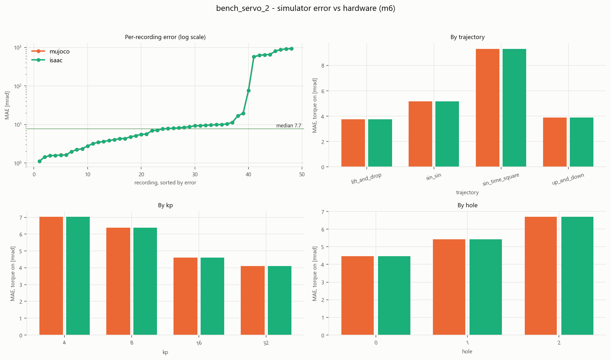

# Servo model and identification

The Feetech STS3215 servo model the policy trains against, and the tools to identify a real servo
and prove that both simulators reproduce it.

The model is a batched PyTorch port of Rhoban's [BAM](https://github.com/Rhoban/bam), with gear
backlash and the firmware dead zone added. Isaac Lab, MuJoCo and the tests all run the same
implementation. Training needs only [`bam_kernel.py`](bam_kernel.py) (and `backlash.py` for MuJoCo).
Everything else here is identification tooling.

```
actuator/
├── bam_kernel.py        The model: BamParams, BamKernel, LostMotion, BamServo, apply_stall_cap
├── backlash.py          MuJoCo backlash: adds a passive lash hinge to each joint of an MJCF
├── params/              Servo parameters (BAM JSON files), PROVENANCE.md, LICENSE-BAM
├── rig.py               Real pendulum arm -> the equivalent point pendulum BAM wants
├── rig/                 rig.yaml (your numbers), pendulum_arm.urdf, loads.json (generated)
├── logset.py            Loads a recording session and its rig metadata (numpy only)
├── validate.py          Score parameter files against a session of recordings
├── replay.py            Replay a session through MuJoCo and Isaac, against the hardware
├── replay_isaac.py      The Isaac worker that replay.py launches (not run directly)
├── plots.py, plotstyle.py   The two figure forms and their shared style
├── parity/              Tests that each simulator reproduces the kernel
├── data/<session>/      Raw recordings copied off the robot
├── media/               Figures used below
└── requirements.txt     bam (pinned), optuna, matplotlib, pytest: tooling only
```

The Isaac side of the model is [`envs/assets/robotV2/bam_actuator.py`](../envs/assets/robotV2/bam_actuator.py).

---

## The model

Each physics step (200 Hz) the servo turns a target joint angle into a joint torque:

```
target angle (from the action pipeline)
  -> command delay            fractional-sample ring buffer, `command_delay`
  -> slew limiter             the internal target moves at most max_velocity * dt per step
  -> dead zone                no drive while |target - encoder| <= deadband
  -> firmware P loop          duty = kp * 0.166 * error_gain_ratio * error, clamped to +-0.97
  -> DC motor with back-EMF   torque = kt * vin * duty / R - kt^2 * dq / R
  -> friction budget          stiction clip: friction can stop the joint, never reverse it
  -> backlash (optional)      rotor and output joined through a gap
torque = motor + friction
```

| Component | Where | What it does |
|---|---|---|
| Firmware loop | `BamKernel.motor` | Delay, slew limit, dead zone, P-only duty, motor torque with back-EMF |
| Friction | `BamKernel.friction_budget`, `stop_clip` | Base, viscous, Stribeck and load-dependent friction (the `m1`..`m6` terms), applied as a clip that cannot add energy |
| Dead zone | `BamKernel.deadband` | The firmware's `CW/CCW_DEADBAND` registers, in encoder counts of 2 pi / 4096 |
| Stall cap | `apply_stall_cap` | Caps the duty-limited stall torque by raising `R`, which leaves the no-load speed alone |
| Backlash, Isaac | `LostMotion` | Virtual rotor moving through a gap; no torque in free play, a capped impulse at re-engagement |
| Backlash, MuJoCo | `backlash.py` | A passive hinge in series with each servo, with stiff limits |
| Composition | `BamServo` | Kernel plus optional lost-motion, the same in every simulator |

### What each simulator supplies

The kernel knows the servo and nothing about the body attached to it. Each step the caller passes
two things: the external torque on the joint (gravity, contacts, coupling) and the joint's
effective inertia, which only the stiction clip uses.

| | External torque | Effective inertia |
|---|---|---|
| Pendulum tests | Exact gravity torque | `m L^2 + armature` |
| MuJoCo | `-qfrc_bias + qfrc_constraint`, from the previous solve | `1 / (M^-1)_ii` via `mj_solveM` |
| Isaac | Lagged observer: `I * qdd - tau_applied` from the previous substep | `1 / (M^-1)_ii` from PhysX, with armature added |

The inertia is `1 / (M^-1)_ii`, not the diagonal `M_ii`. The stiction clip is a one-step deadbeat on
velocity, and on a floating base `M_ii` overestimates what a torque on one joint moves, so it
over-corrects into chatter. PhysX's mass matrix excludes armature; `BamActuator` checks this at
startup and logs the result.

### Backlash

- **MuJoCo** gets the faithful model: a passive hinge in series with each servo, with the play
  limited to `+-lash/2`. `BipedEnvV2` writes the modified MJCF when `backlash.enabled` is true and
  `mujoco_lash_deg` is above 0.
- **Isaac** cannot add a joint per servo cheaply, so `LostMotion` tracks a virtual rotor through
  the gap. Its known approximation: the output keeps the rotor's inertia during free play.
- **`encoder_side`** says which side of the gap the encoder reads. `output` (the default) reads the
  output link, so the firmware and the policy both see the play, as with the STS3215's output-side
  sensor. `servo` reads the rotor, so neither sees it.

### Differences from BAM

The kernel follows BAM's `simulate.py` and `model.py`, the code the parameters were fitted against.

- `q_offset` is ignored: it is a bench calibration term with no meaning on a robot.
- The command delay uses a causal ring buffer instead of shifting the goal sequence. The results
  are identical.
- `friction_scale`, `torque_scale` and `deadband` are added for randomization and the servo's
  registers. At their defaults (`1`, `1`, `0`) they change nothing.

---

## Using it in training

Both simulators read the same two config blocks:

```yaml
train:
  env_config:
    actuator:
      params_file: actuator/params/sts3215_12v/m6.json
      kp_fw: 32                    # firmware P register; must equal the robot's
      kp_fw_range: [32, 40]        # sim only: per-robot draw, per episode
      vin_range: [11.1, 12.6]      # supply voltage, drawn per robot at startup
      friction_scale_range: [0.8, 1.2]
      torque_scale: 1.0            # TORQUE_LIMIT / 1000 on the servos
      stall_torque_cap_nm: 2.94    # cap the stall torque (null = trust the params)
      deadband_counts: 1           # nominal dead zone, in encoder counts
      deadband_counts_range: [1, 1]
      tau_ext_source: observer     # or "gravity", to debug the external-torque estimate
    backlash:
      enabled: true
      lash_deg_range: [1.0, 2.5]   # total gear play per joint, drawn per servo at startup
      mujoco_lash_deg: 1.5         # fixed play of the MuJoCo hinge
      impulse_cap: 2.94            # N*m cap on the re-engagement knock
      encoder_side: output
```

| Key | Isaac | MuJoCo |
|---|---|---|
| `params_file`, `kp_fw`, `torque_scale`, `stall_torque_cap_nm`, `deadband_counts`, `encoder_side` | Used | Used |
| `kp_fw_range`, `friction_scale_range`, `lash_deg_range`, `deadband_counts_range` | Drawn per robot | Ignored |
| `vin_range` | Drawn per robot | Fixed at 12 V |
| `tau_ext_source`, `impulse_cap` | Used | Ignored |
| `backlash.enabled` | Lost-motion model | Passive hinge, if `mujoco_lash_deg` > 0 |

The per-robot draws are the `randomize_bam_actuator` event (startup) and the stiffness draw in
`BipedEnv._reset_idx`. They apply only with `enable_physics_randomization: true`. Without it
(playback, `play.py`) the servo is nominal: mid-range voltage and lash, `kp_fw`.

Keep in sync with the real robot: `kp_fw` must equal the servo's P register (with D = I = 0),
`torque_scale` the `TORQUE_LIMIT` register, and the dead zone the `DEADBAND` registers. The
exporter records the params file, its SHA-256 and the required P gain in `deploy_config.json`.

To check the servo in the full robot, before spending a training run:

```bash
python src/isaaclab/check_actuator.py --headless          # Isaac Lab python, from the repo root
```

It reports PASS or FAIL for the actuator type, the armature probe, the action map, the mount-offset
sign, the external-torque observer, the sampled servo population and standing stability. Useful
flags: `--num_envs`, `--seconds`, `--config_path`, `--no-backlash`, `--tau-ext observer|gravity`.

---

## Identify a new servo

The aim is a params file in BAM's format, validated against your own servo. The tools expect the
BAM bench protocol: one servo swinging a known pendulum, recorded at about 250 Hz.

**Setup.** `bam` needs its own environment (it may pin older package versions than Isaac Lab).
Create one for the tooling and install `actuator/requirements.txt`. `validate.py` and the BAM fit
run there. `replay.py` and the parity scripts that need Isaac run in the Isaac Lab environment.

1. **Build the rig.** An arm on the servo axis, with a weight you can move between holes. Export the
   bare arm as a URDF with its origin on the rotation axis. Weigh the payload.
2. **Describe it.** Edit [`rig/rig.yaml`](rig/rig.yaml): the URDF path, rotation axis, payload mass,
   hole radii, supply voltage and the `kp_sweep`. Then:

   ```bash
   python -m actuator.rig --config actuator/rig/rig.yaml
   ```

   It prints the equivalent point pendulum (`mass`, `length`) for each hole, the peak gravity
   torque as a share of the continuous rating (with warnings if too high or too low), and writes
   `rig/loads.json`. Copy that file to `data/sysid/loads.json` on the robot's Jetson.
3. **Record.** In the Jetson's SysID tab ([BipedRobotJetson](https://github.com/AsterisCrack/BipedRobotJetson)):
   start a session for the servo id, capture the hanging zero, record every trajectory at every
   `kp` and hole, and download the session zip. Do not remount the servo mid-session: BAM fits one
   offset across all of it. Unzip so the recordings (`<time>_<trajectory>_kp<kp>_h<hole>.json`) sit
   directly in `actuator/data/<session>/`.
4. **Validate.** Do the published parameters already describe this servo?

   ```bash
   python -m actuator.validate --session actuator/data/<session>
   ```

   It sets aside saturated recordings, resamples with `bam.process`, scores every model in the
   params directory with `bam.mae`, rolls the best one out over every log and draws the figures.
   Read the **torque-on** number: it is the only regime the policy runs in. Within about 2x of the
   published hold-out, keep the shipped parameters. Several times worse, fit your own.
5. **Fit your own** (only if needed), then validate it the same way:

   ```bash
   python -m bam.fit --actuator sts3215 --model m6 --logdir actuator/data/<session>/processed \
                     --validation_kp 8 --output actuator/params/<yours>/m6.json
   python -m actuator.validate --session actuator/data/<session> --params actuator/params/<yours>
   ```

6. **Replay through both simulators.** This answers a different question: does the model still
   behave the same once it sits inside the simulator the policy trains in?

   ```bash
   python -m actuator.replay --session actuator/data/<session> --model m6 --params actuator/params/<yours>/m6.json
   ```

7. **Run the parity tests** (below) if you changed the kernel or a simulator integration.
8. **Set the robot-specific values.** On the robot, suspended, use the SysID tab's **Screen all
   joints** to measure per-joint hysteresis (backlash plus friction deadband) and set
   `backlash.lash_deg_range`. Read the `TORQUE_LIMIT` and `DEADBAND` registers (the Jetson's
   `tools/servo_registers.py`) for `torque_scale` and `deadband_counts`. Set `stall_torque_cap_nm`
   to the datasheet stall unless you have stalled-torque data.
9. **Point the config at it.** Set `actuator.params_file`. Nothing else changes.

---

## Tools

| Script | Needs | Purpose |
|---|---|---|
| `python -m actuator.rig` | `pyyaml` | `--config` (default `actuator/rig/rig.yaml`), `--json` (output path) |
| `python -m actuator.validate` | `bam` | `--session` (required), `--params <dir>` (default `params/sts3215_12v`), `--dt` (0.005), `--keep-saturated`, `--plot-model <name>\|best\|none` |
| `python -m actuator.replay` | torch, MuJoCo, Isaac | `--session` (required), `--model` (`m6`), `--params <json file>`, `--sims mujoco,isaac`, `--stall-cap <N*m>`, `--reuse` |
| `actuator/replay_isaac.py` | Isaac Lab | The Isaac worker `replay.py` spawns |

`validate.py` writes into the session folder: `_raw_ok/` (recordings that passed the saturation
screen), `processed/` (resampled), `mae.json` (scores), `plots/`. A recording is saturated when
torque is on, `|speed| < 0.05 rad/s` and `|goal - position| > 0.2 rad` for at least 10% of frames.
Saturated frames make a fit inflate `R` and deflate `kt`.

`replay.py` replays open-loop: the simulator gets the recorded goal and `torque_enable`, starts from
the recorded initial state and is never corrected afterwards. MuJoCo and Isaac each run in their own
subprocess, because MuJoCo's library does not load inside a running Isaac process. Results are cached
in `<session>/_sim/<sim>_<model>.npz`; `--reuse` redraws from the cache and skips the Kit launch.

### The figures

| File in `<session>/plots/` | From | Shows |
|---|---|---|
| `fit_<model>_h<hole>.png` | `validate` | Recorded against the BAM rollout, one panel per (trajectory, kp) |
| `summary_<model>.png` | `validate` | Per-recording error sorted, then error by trajectory, kp and hole |
| `sim_<model>_h<hole>.png` | `replay` | Recorded against MuJoCo against Isaac |
| `sim_summary_<model>.png` | `replay` | The same breakdown, per simulator |

**Read the torque-on error, not the session mean.** A session mixes two different regimes. With
torque on, the error says whether the servo model tracks. With torque off (the grey bands) nothing
drives the joint, and the error measures whether the model's stiction matches the gearbox. On a
roughly 330:1 geared servo it usually does not: the real arm stays where it was left and the model
lets it fall. A few such recordings can drag a 5 mrad session average to 130 mrad.

### Parity tests

Run these after touching the kernel or either simulator integration. All but `test_lost_motion`
need `bam`.

```bash
python -m actuator.parity.test_kernel_vs_bam               # kernel == BAM, float64
python -m actuator.parity.test_lost_motion                 # backlash behaviour, torch only
python -m actuator.parity.mujoco_pendulum --lash-deg 1.5   # kernel inside MuJoCo vs BAM
python actuator/parity/isaac_pendulum.py --headless        # BamActuator inside PhysX vs BAM (Isaac python)
```

| Test | Checks | Bar |
|---|---|---|
| `test_kernel_vs_bam` | Every model `m1`..`m6`, every built-in trajectory, two `kp` in one batch, against BAM's own simulator | 1e-9 rad |
| `test_lost_motion` | `lash = 0` is an exact no-op; a reversal has torque-free dead time that scales with the lash; the output stays bounded | Asserts |
| `mujoco_pendulum` | The kernel driving MuJoCo like `BipedEnvV2` does; `--lash-deg` adds a backlash hinge and reports its effect | 10 mrad MAE |
| `isaac_pendulum` | `BamActuator` on a PhysX pendulum; `--tau-ext observer\|gravity`, `--out <file>` | 10 mrad MAE |

`isaac_pendulum.py` needs Isaac Lab and `bam` importable in the same interpreter. The 10 mrad bar
is BAM's own "likely a kernel bug" threshold for real integrators, which cannot be
bit-exact against BAM's explicit-Euler loop.

---

## Parameter files

`params/` holds BAM params JSON files, exactly what `python -m bam.fit --output <file>` writes.
`BamParams.from_json` rejects unknown keys and missing keys the model variant needs, so a misspelt
key cannot silently zero a friction term.

| Folder | Use |
|---|---|
| `sts3215_12v/m1.json` .. `m6.json` | The shipped fit, from BAM pull request #20. `m6` is the default |
| `sts3215_7_4v/` | Reference only: fitted at the wrong supply voltage for this robot |
| `PROVENANCE.md` | Source commits, licence, quirks of the published fit (do not hand-edit the values) |

The variants add friction terms in steps: `m1` base and viscous, `m2` adds Stribeck, `m3` adds load
dependence, `m4` load and Stribeck, `m5` directional load and Stribeck, `m6` adds quadratic load
terms. Main `m6` values:

| Parameter | Value | |
|---|---|---|
| `kt` | 2.2617 | N m/A through the gearbox |
| `R` | 4.1581 | ohm |
| `armature` | 0.023423 | kg m^2, rotor inertia reflected through the gearbox |
| `max_velocity` | 4.9164 | rad/s, the firmware slew clamp |
| `command_delay` | 0.005565 | s |
| `error_gain_ratio` | 1.0737 | firmware P scaling |

`kt`, `R` and `error_gain_ratio` are degenerate as a group (the logs only fix `kt * ratio / R` and
`kt^2 / R`), so do not read physical meaning into one of them alone.

---

## Results

Validation of the shipped `m6` against one STS3215 on the pendulum rig: 48 recordings, 4
trajectories x kp {4, 8, 16, 32} x 3 payload holes, 6 s each at about 250 Hz.

**Verdict: the published parameters describe this servo. No refit.**

| Model | Torque-on MAE (mrad) | Published hold-out (mrad) |
|---|---|---|
| `m1` | 6.14 | 21 |
| `m5` | 5.44 | |
| `m6` | 5.53 | 10 |

`m5` is better by a margin within noise, and it pins three friction terms near zero and `alpha` on
its bound, so `m6` stays.



**The one real gap is stiction.** Most recordings land near or under 10 mrad. The eight that are
hundreds of mrad off are all `lift_and_drop` at the two heavier holes: it cuts torque mid-swing, the
real arm holds its position and the model sweeps back to hanging (about 760 mrad torque-off, against
5.5 mrad torque-on).



That costs nothing for tracking, but it is wrong for impacts, falls and a leg loaded by the ground.
If that behaviour starts to matter, raise the stiction terms; do not refit the whole model.

**Both simulators reproduce the kernel.**



| | Torque-on MAE (mrad) |
|---|---|
| BAM reference (`bam.simulate`) | 5.53 |
| MuJoCo (`replay.py`) | 5.53 |
| Isaac / PhysX (`replay_isaac.py`) | 5.53 |

MuJoCo and Isaac agree with each other to about 0.06 mrad worst case, far below the error against
hardware.

### Speed and torque

| | Value |
|---|---|
| Effective max speed | 4.92 rad/s (the `max_velocity` clamp binds before the motor line, 5.15 rad/s at 12 V) |
| Stall torque, raw fit at 12 V | 6.33 N m (`0.97 * V * kt / R`) |
| Stall torque, as configured | 2.94 N m (`stall_torque_cap_nm`, the datasheet value) |

Trust the speed: the recordings reach a peak slightly above it. Treat the torque as a datasheet
assumption. The heaviest load on the rig was about 15% of the datasheet stall, so nothing in the
data constrains behaviour near stall, and the raw fit implies about twice the datasheet torque. The
cap is applied by raising `R`, because scaling the duty ceiling instead would slow the servo down
as well. Validating the real stall needs a stalled-torque rig.

---

## Why the arm is reduced to two numbers

For one revolute joint the full rigid-body dynamics are

```
I * qdd = tau_motor - g * S * sin(q) - friction
```

where `I` is the inertia about the axis and `S = sum(m_i d_i)` the gravity-torque coefficient.
Every geometric detail of the arm enters only through those two scalars, so two bodies with equal
`I` and `S` cannot be told apart by any experiment on that joint.

BAM's logs describe a rod with a tip weight. Setting its `arm_mass` to 0 gives a point pendulum,
with `inertia = mass L^2` and gravity coefficient `mass L`. That is an exact reparameterisation:

```
L = I / S          mass = S^2 / I
```

`rig.py` does this, and the round trip is exact to machine precision. Two caveats:

- **Flexibility** cannot be represented. A bending arm is not a rigid body, and its mode is absorbed
  into the fit as fictitious friction. Keep the arm stiff in the swing plane.
- **Sizing.** `rig.py` warns when the peak gravity torque nears the continuous rating (recordings
  then saturate; `validate.py` screens them out regardless) or is too low (the load-dependent
  friction terms are poorly identified). The servo's rotor inertia (the `armature`) dominates a
  light arm, so excitation comes from the gravity torque `S`, not the inertia. Get the payload
  mass and hole radii right; a few percent on the inertia tensor does not matter.
